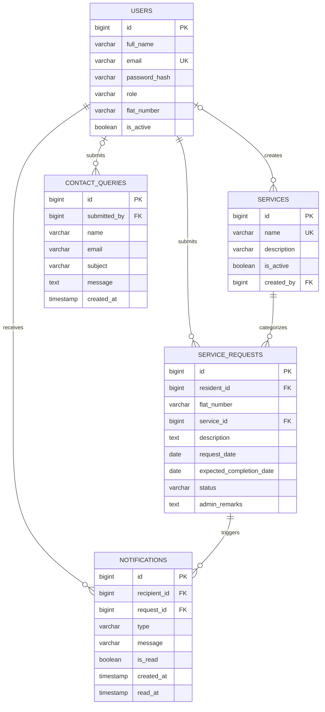

# Data model

Types below use MySQL 8 conventions. All tables use InnoDB. Timestamps are stored in UTC. Fixed role and request-status values are enforced by application enums/constants and database constraints where supported.

## Tables

### `users`

| Column | Type | Constraints |
|---|---|---|
| id | BIGINT UNSIGNED | PK, auto increment |
| full_name | VARCHAR(120) | NOT NULL |
| email | VARCHAR(254) | NOT NULL; normalized lowercase |
| password_hash | VARCHAR(60) | NOT NULL; BCrypt only |
| role | VARCHAR(20) | NOT NULL; `USER`, `ADMIN`, `SUPER_ADMIN` |
| flat_number | VARCHAR(30) | NULL; required by application for USER accounts, null for staff |
| is_active | BOOLEAN | NOT NULL DEFAULT TRUE |
| created_at | TIMESTAMP(6) | NOT NULL DEFAULT CURRENT_TIMESTAMP(6) |
| updated_at | TIMESTAMP(6) | NOT NULL DEFAULT CURRENT_TIMESTAMP(6) ON UPDATE CURRENT_TIMESTAMP(6) |

Indexes/constraints: PK(id), UNIQUE(email), INDEX(role,is_active). Email uniqueness is case-insensitive via a case-insensitive collation or normalized lowercase storage. Role/flat-number relationship is validated in application logic.

### `services`

| Column | Type | Constraints |
|---|---|---|
| id | BIGINT UNSIGNED | PK, auto increment |
| name | VARCHAR(100) | NOT NULL |
| description | VARCHAR(500) | NULL |
| is_active | BOOLEAN | NOT NULL DEFAULT TRUE |
| created_by | BIGINT UNSIGNED | NULL, FK users(id), ON DELETE SET NULL |
| created_at | TIMESTAMP(6) | NOT NULL DEFAULT CURRENT_TIMESTAMP(6) |
| updated_at | TIMESTAMP(6) | NOT NULL DEFAULT CURRENT_TIMESTAMP(6) ON UPDATE CURRENT_TIMESTAMP(6) |

Indexes/constraints: UNIQUE(name), INDEX(is_active,name). Catalog services are deactivated, not deleted when referenced.

### `service_requests`

| Column | Type | Constraints |
|---|---|---|
| id | BIGINT UNSIGNED | PK, auto increment |
| resident_id | BIGINT UNSIGNED | NOT NULL, FK users(id), ON DELETE RESTRICT |
| flat_number | VARCHAR(30) | NOT NULL (snapshot at submission) |
| service_id | BIGINT UNSIGNED | NOT NULL, FK services(id), ON DELETE RESTRICT |
| description | TEXT | NOT NULL |
| request_date | DATE | NOT NULL |
| expected_completion_date | DATE | NOT NULL |
| status | VARCHAR(20) | NOT NULL DEFAULT `PENDING`; one of four defined statuses |
| admin_remarks | TEXT | NULL |
| created_at | TIMESTAMP(6) | NOT NULL DEFAULT CURRENT_TIMESTAMP(6) |
| updated_at | TIMESTAMP(6) | NOT NULL DEFAULT CURRENT_TIMESTAMP(6) ON UPDATE CURRENT_TIMESTAMP(6) |

Indexes/constraints: INDEX(resident_id,created_at), INDEX(status,expected_completion_date), INDEX(service_id), CHECK(expected_completion_date >= request_date), CHECK(status IN ('PENDING','IN_PROGRESS','COMPLETED','REJECTED')). `overdue` is not a column; compute `expected_completion_date < current date AND status IN ('PENDING','IN_PROGRESS')`.

### `notifications`

| Column | Type | Constraints |
|---|---|---|
| id | BIGINT UNSIGNED | PK, auto increment |
| recipient_id | BIGINT UNSIGNED | NOT NULL, FK users(id), ON DELETE CASCADE |
| request_id | BIGINT UNSIGNED | NOT NULL, FK service_requests(id), ON DELETE CASCADE |
| type | VARCHAR(40) | NOT NULL; currently `REQUEST_STATUS_CHANGED` |
| message | VARCHAR(500) | NOT NULL |
| is_read | BOOLEAN | NOT NULL DEFAULT FALSE |
| created_at | TIMESTAMP(6) | NOT NULL DEFAULT CURRENT_TIMESTAMP(6) |
| read_at | TIMESTAMP(6) | NULL |

Indexes/constraints: INDEX(recipient_id,is_read,created_at), INDEX(request_id). Recipient ownership must be verified for read/list operations.

### `contact_queries`

| Column | Type | Constraints |
|---|---|---|
| id | BIGINT UNSIGNED | PK, auto increment |
| submitted_by | BIGINT UNSIGNED | NULL, FK users(id), ON DELETE SET NULL |
| name | VARCHAR(120) | NOT NULL |
| email | VARCHAR(254) | NOT NULL |
| subject | VARCHAR(200) | NOT NULL |
| message | TEXT | NOT NULL |
| created_at | TIMESTAMP(6) | NOT NULL DEFAULT CURRENT_TIMESTAMP(6) |

Indexes/constraints: INDEX(created_at), INDEX(email). Anonymous contact submissions have `submitted_by=NULL`.

## ER diagram

The exact MySQL collation and migration-level enforcement of enum-like values should be selected when migrations are authored.
