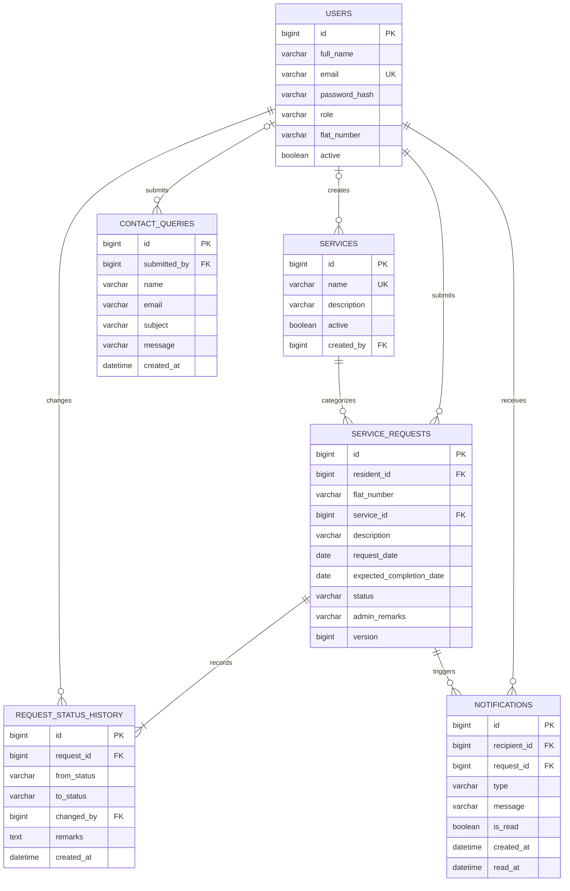

# Data model

Target database is MySQL 8.4 LTS with InnoDB. Every table uses `CHARACTER SET utf8mb4 COLLATE utf8mb4_0900_ai_ci`. IDs and foreign keys are signed `BIGINT`. All timestamp columns use `DATETIME(6)` in UTC with `CURRENT_TIMESTAMP(6)` defaults (and `ON UPDATE CURRENT_TIMESTAMP(6)` for updated_at). Configure JDBC and Hibernate to UTC. Application business dates use `RMS_TIMEZONE` (default `Asia/Kolkata`) through one injectable `Clock`.

All strings are trimmed before validating shared field limits in `requirements.md`: full_name 2-120; email max 254; flat_number 1-30; service name 2-100; service description max 500; request description 5-1000; admin_remarks max 1000 (required and non-blank when setting `REJECTED`); contact name 2-120; subject 3-200; message 5-2000. Password: at least 8 characters, at most 72 UTF-8 bytes, and contains a letter and digit.

## `users`

| Column | Type | Constraints |
|---|---|---|
| id | BIGINT | PK, auto increment |
| full_name | VARCHAR(120) | NOT NULL |
| email | VARCHAR(254) | NOT NULL, stored lowercase |
| password_hash | VARCHAR(100) | NOT NULL, BCrypt only |
| role | VARCHAR(20) | NOT NULL, `USER`, `ADMIN`, or `SUPER_ADMIN` |
| flat_number | VARCHAR(30) | NULL; required for USER, null for other roles |
| active | BOOLEAN | NOT NULL DEFAULT TRUE |
| created_at | DATETIME(6) | NOT NULL DEFAULT CURRENT_TIMESTAMP(6), UTC |
| updated_at | DATETIME(6) | NOT NULL DEFAULT CURRENT_TIMESTAMP(6) ON UPDATE CURRENT_TIMESTAMP(6), UTC |

Constraints/indexes: PK(id), UNIQUE(email), INDEX(role,active), CHECK(role IN ('USER','ADMIN','SUPER_ADMIN')), CHECK((role='USER' AND flat_number IS NOT NULL) OR (role<>'USER' AND flat_number IS NULL)).

## `services`

| Column | Type | Constraints |
|---|---|---|
| id | BIGINT | PK, auto increment |
| name | VARCHAR(100) | NOT NULL |
| description | VARCHAR(500) | NULL |
| active | BOOLEAN | NOT NULL DEFAULT TRUE |
| created_by | BIGINT | NULL, FK users(id), ON DELETE RESTRICT |
| created_at | DATETIME(6) | NOT NULL DEFAULT CURRENT_TIMESTAMP(6), UTC |
| updated_at | DATETIME(6) | NOT NULL DEFAULT CURRENT_TIMESTAMP(6) ON UPDATE CURRENT_TIMESTAMP(6), UTC |

Constraints/indexes: UNIQUE(name), INDEX(active,name). Deactivate rather than delete. Flyway seeds Plumbing, Electrical, Cleaning, Painting, and Internet Repair; no users are seeded.

## `service_requests`

| Column | Type | Constraints |
|---|---|---|
| id | BIGINT | PK, auto increment |
| resident_id | BIGINT | NOT NULL, FK users(id), ON DELETE RESTRICT |
| flat_number | VARCHAR(30) | NOT NULL; copy of resident profile at creation |
| service_id | BIGINT | NOT NULL, FK services(id), ON DELETE RESTRICT |
| description | VARCHAR(1000) | NOT NULL |
| request_date | DATE | NOT NULL; assigned by server in `RMS_TIMEZONE` |
| expected_completion_date | DATE | NOT NULL |
| status | VARCHAR(20) | NOT NULL DEFAULT `PENDING`; one of four request statuses |
| admin_remarks | VARCHAR(1000) | NULL |
| version | BIGINT | NOT NULL DEFAULT 0; optimistic locking |
| created_at | DATETIME(6) | NOT NULL DEFAULT CURRENT_TIMESTAMP(6), UTC |
| updated_at | DATETIME(6) | NOT NULL DEFAULT CURRENT_TIMESTAMP(6) ON UPDATE CURRENT_TIMESTAMP(6), UTC |

Indexes: INDEX(resident_id,created_at), INDEX(status,expected_completion_date), INDEX(service_id). Checks: CHECK(expected_completion_date >= request_date), CHECK(status IN ('PENDING','IN_PROGRESS','COMPLETED','REJECTED')). Application enforces status transitions and non-blank remarks when setting `REJECTED`. Concurrent updates return 409 `CONCURRENT_MODIFICATION`. `overdue` is computed, never stored: expected completion date is before current date in `RMS_TIMEZONE` AND status is `PENDING` or `IN_PROGRESS`; `COMPLETED` and `REJECTED` are never overdue.

## `request_status_history`

| Column | Type | Constraints |
|---|---|---|
| id | BIGINT | PK, auto increment |
| request_id | BIGINT | NOT NULL, FK service_requests(id), ON DELETE RESTRICT |
| from_status | VARCHAR(20) | NULL only for initial entry; otherwise valid request status |
| to_status | VARCHAR(20) | NOT NULL, valid request status |
| changed_by | BIGINT | NOT NULL, FK users(id), ON DELETE RESTRICT |
| remarks | TEXT | NULL |
| created_at | DATETIME(6) | NOT NULL DEFAULT CURRENT_TIMESTAMP(6), UTC |

Indexes/checks: INDEX(request_id,created_at), CHECK(from_status IS NULL OR from_status IN ('PENDING','IN_PROGRESS','COMPLETED','REJECTED')), CHECK(to_status IN ('PENDING','IN_PROGRESS','COMPLETED','REJECTED')). Insert initial NULL -> PENDING row changed by resident at request creation and a row for every actual status change in the same transaction as the update. Initial remarks are NULL; later remarks copy supplied admin remarks and may be NULL.

## `notifications`

| Column | Type | Constraints |
|---|---|---|
| id | BIGINT | PK, auto increment |
| recipient_id | BIGINT | NOT NULL, FK users(id), ON DELETE RESTRICT |
| request_id | BIGINT | NOT NULL, FK service_requests(id), ON DELETE RESTRICT |
| type | VARCHAR(40) | NOT NULL; currently `REQUEST_STATUS_CHANGED` |
| message | VARCHAR(500) | NOT NULL |
| is_read | BOOLEAN | NOT NULL DEFAULT FALSE |
| created_at | DATETIME(6) | NOT NULL DEFAULT CURRENT_TIMESTAMP(6), UTC |
| read_at | DATETIME(6) | NULL, UTC |

Indexes: INDEX(recipient_id,is_read,created_at), INDEX(request_id). Residents can access only their own notifications.

## `contact_queries`

| Column | Type | Constraints |
|---|---|---|
| id | BIGINT | PK, auto increment |
| submitted_by | BIGINT | NULL, FK users(id), ON DELETE RESTRICT |
| name | VARCHAR(120) | NOT NULL |
| email | VARCHAR(254) | NOT NULL, stored lowercase |
| subject | VARCHAR(200) | NOT NULL |
| message | VARCHAR(2000) | NOT NULL |
| created_at | DATETIME(6) | NOT NULL DEFAULT CURRENT_TIMESTAMP(6), UTC |

Indexes: INDEX(created_at), INDEX(email). Anonymous submissions have `submitted_by=NULL`. No record with history is hard-deleted.

## Seed and demo data

Flyway inserts active services Plumbing, Electrical, Cleaning, Painting, and Internet Repair. No users are seeded; SUPER_ADMIN is created from environment variables. A future `demo` profile may seed screenshot data and must never run in production.

## ER diagram

